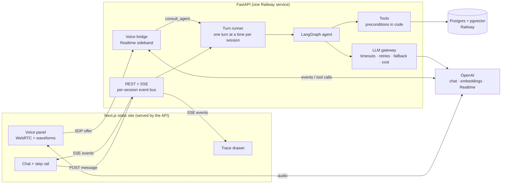

# Nimbus Support Agent

A customer support agent for a fictional SaaS company, **Nimbus**. You can type to it or talk to it. Both run the
**same** LangGraph agent, so they share the tools, guardrails, live step indicators, trace and memory.

**Live demo:** https://nimbus-support-agent-production.up.railway.app · **Walkthrough:** _Loom link_

- **Streaming chat:** SSE with live step indicators ("Verifying account & tier…", "Searching knowledge base…").
- **Live voice:** OpenAI Realtime over WebRTC, with waveforms, live transcripts and barge-in. The API key stays on the server.
- **Multi-step tools:** verify identity → read invoices → retrieve tier-specific policy → refund, update the account or open a ticket. The rules are enforced in code.
- **Confidence guardrails:** three bands tuned on labelled queries, a source check on borderline answers, and escalation to a human with a ticket.
- **Observability drawer:** per-turn span tree, latency (time to first token, or speech end to first audio), tokens and estimated cost.
- **Resilience:** timeouts, retries, a cross-provider fallback, and a failure simulator for the demo. Limits and a daily spend cap protect the public endpoint.

## Try it

Use one of these demo accounts (account ID + PIN). The PINs are fake and exist only in the seed data.

| Account | PIN | Customer | Plan | Contract | Try |
|---|---|---|---|---|---|
| C-1001 | 4321 | Dana Lee | Pro | active | "Refund INV-2207" (allowed) · "Refund the full $490 on INV-2099" (over the $200 limit) |
| C-1002 | 2468 | Omar Haddad | Enterprise | active | "Refund $1,000 of INV-3101" |
| C-1003 | 1357 | Priya Shah | Free | active | "Refund INV-1202" (free plan isn't eligible) |
| C-1004 | 8642 | Marco Rossi | Pro | expired | Any refund (contract not active) |
| C-1006 | 1122 | Sam Carter | Pro | active | "Show my invoices" (the invoice system always fails, so you get a ticket) |

Out-of-scope questions ("Do you sell Wi-Fi routers?") escalate to a ticket. The drawer's **Simulate failures** menu
injects a model timeout, a 429, a full outage, or a failing or slow tool into your own session only.

The demo CRM is shared by every visitor, so it **resets every hour** (and on every deploy): refunds are cleared and the
accounts are restored. If an invoice says it's already refunded, someone got there first; try another account.

## Architecture



- **One brain for chat and voice.**
  - In voice, the Realtime model only listens, speaks and handles interruptions. For anything substantive it calls one tool, `consult_agent`. Our server receives that call on its own connection to the live call (the "sideband"), runs the same agent turn as chat, and returns the answer for the model to speak.
  - The browser sends its WebRTC offer to our backend, which creates the call with the server key. The browser never holds a key.
- **The agent graph** (`backend/app/agent/`):

  `classify → agent ⇄ tools → guardrail → respond → verify_answer`, with escalation branches.

  - Routing rules that matter for safety are pure functions in `guardrails.py`. The model never decides them.
  - Every turn first gets a fast **classify** call (small talk / policy / account action / mixed / out of scope).
  - If the turn is about policy and the agent didn't search, **code forces the search**. No policy answer comes from model memory.
- **Tools** (`backend/app/tools/`): each tool checks its own preconditions and returns structured errors the agent can recover from. The runner emits step events, records a span and injects simulated faults. It never raises.
- **Events:** chat and voice publish to one per-session SSE stream (`id:` = sequence number, resumable with `Last-Event-ID`). The TypeScript types are generated from the backend's OpenAPI schema (`npm run gen:types`), and CI fails if they drift.

## Retrieval and chunking

10 policy documents written for this project (`data/policies/`):

- Chunks are split at **H2/H3 headings**: one section is one chunk, because a policy rule and its exceptions belong together. Fixed-size windows would split them.
- A section is split further only if it exceeds 500 tokens, with a 50-token overlap only inside that section.
- **The breadcrumb is embedded with the text** (`Refund Policy > Pro plan`). "Up to $200 within 30 days" means nothing on its own.
- **Tier tags on sections** (`## Pro plan {tier=pro}`). Retrieval is filtered to `all` plus the verified customer's tier:
  - The tier comes only from `verify_customer`; `search_policies` has no tier argument.
  - Unverified callers see public documents only.
  - Plan descriptions are public, because anyone may ask what Enterprise includes. Entitlement policies (refunds, SLA, cancellation) are tier-tagged.
- **Ingest is idempotent.** It's keyed on a hash of tier, type and text, re-embeds when the embedding model changes, and refuses to run if the refund limits stated in the documents disagree with the `policy_limits` table the code enforces.
- Embeddings: `text-embedding-3-small`, cosine similarity with an HNSW index, top-5.
- Each search runs twice: once with the model's query and once with the customer's own last message, keeping each chunk's best score. The model tends to shorten questions ("plans offered"), and the short form scores lower than the customer's wording, which the thresholds below were tuned on.

## Guardrails

| Band | Top score | What happens |
|---|---|---|
| high | ≥ 0.52 | Answer from the retrieved sources |
| grey | 0.44 – 0.52 | Draft an answer, then an LLM check that every claim is supported by the sources. Unsupported → escalate |
| low | < 0.44 | No answer; open a ticket for a human |

- **Tuned, not guessed.** The thresholds come from `evals/threshold_sweep.py` over 34 labelled queries (in scope per plan, out of scope, adversarial):

  | | t_low / t_high | Out-of-scope caught outright | Out-of-scope answered unchecked | Needs the source check |
  |---|---|---|---|---|
  | Initial guess | 0.30 / 0.45 | 54% | 1 | 18% |
  | **Tuned** | **0.44 / 0.52** | **92%** | **0** | 9% |

  The full table is in [`evals/results/threshold_sweep.md`](evals/results/threshold_sweep.md). These figures are measured on the same 34 queries used to choose the thresholds, and the margins are thin (one out-of-scope query scores 0.516). The source check is the backstop for that band.
- **Streaming vs. checking.** Chat streams the answer, so a failed check **retracts** it in the UI and escalates. Voice speaks only after the check, so a failed check **blocks** it instead.
- **Code-enforced action rules** (tested in `backend/tests/tools/`):
  - identity before account actions; verification locks after 3 failed attempts in a conversation and after 10 per account per hour;
  - refunds must be inside the plan's window and need an active contract;
  - the plan limit is **per invoice, across all conversations**, and a refund can't exceed what was paid, even when two refunds run at once (row lock);
  - retries are idempotent;
  - **the refund amount must be the full invoice or an amount the customer actually stated**. The evals caught the agent "helpfully" refunding $200 when $490 was asked for. In voice, only the customer's transcribed words count, never the voice model's paraphrase.
- **Voice drift check:** after each spoken reply, a small model compares what was said with the agent's answer. Replies the voice gave without consulting the agent are checked for unsourced policy or account claims. Either kind of problem shows as a red `voice_drift` span in the trace.

## Evals

`evals/run_scenarios.py` runs 11 multi-turn conversations end to end against the real models on the test database. **11/11 passed on two consecutive runs, about $0.025 per run** ([results](evals/results/scenarios.md)). They cover:

- the refund happy path;
- over-limit, expired-contract and free-plan refusals;
- refunds without verification, and a claimed tier;
- out-of-scope escalation and prompt injection;
- a failing invoice system;
- verify-then-act across turns, and accepting the allowed amount.

Unit and integration tests: `backend/` 193 (pytest; real Postgres, scripted LLM, recorded Realtime events) and `frontend/` 39 (vitest).

An independent whole-branch review before deployment found a per-invoice refund-cap bypass across conversations, voice consent taken from the model's paraphrase, and spoofable client IPs, among others. All were fixed with regression tests. Smaller open items are listed under known limitations.

## Voice details

- The event handling was designed from a recorded spike ([`docs/spikes/2026-11-24-realtime-sideband.md`](docs/spikes/2026-11-24-realtime-sideband.md)). The recordings are test fixtures.
- **Memory stores what the customer heard.**
  - Interrupted answers are cut to the audio that actually played (`conversation.item.truncated.audio_end_ms`) and marked interrupted.
  - Holding lines and responses that were never played aren't stored.
- **A holding line is guaranteed.** If the model calls the tool silently, the bridge asks for "One moment…" and waits for it to finish before speaking the answer.
- **Latency:** speech end to first audio is measured server-side. It's about 0.3–0.5 s to the holding line, and the agent answer follows in about 4–7 s.
- **Limits:** 10 minutes per call, 60 s of silence, one call per conversation, 5 calls per hour per IP.

## Trade-offs

- **One brain vs. letting the Realtime model reason.** One brain gives identical guardrails and traces in both modes, at the cost of an extra round trip (masked by the holding line).
- **A separate `respond` step** writes every customer reply from the sources and tool results. It's one more model call per turn, but the agent's own text never reaches the customer.
- **Single instance.** The event bus, rate limiter and voice registry are in memory. Scaling out would move them to Redis.
- **Interruption truncation is estimated** from a ~15 characters/second speaking rate, because the API reports how much audio played but not which words.
- **Sessions are anonymous** (an ID in localStorage). Identity comes from the demo account and PIN, not a login.
- **Small eval set** (34 queries, 11 scenarios). It's enough to tune and catch regressions; a production system would grow it from real traffic.

### Known limitations

- A second partial refund of the same invoice in the same conversation returns the first one (the idempotency key is per conversation and invoice).
- The "stated amount" check is a heuristic: numbers like a PIN or a date count as stated amounts. The plan limit and the invoice total still bound any refund.
- If the caller speaks again while a lookup is running, the spoken answer can be filed under the newer turn.
- The in-memory event buffers and locks are never evicted, which is fine for a demo but not for long-running production use.
- PINs appear in trace spans in the drawer. The demo PINs are fake.

## Run locally

Requires Docker, [uv](https://docs.astral.sh/uv/) and Node 20+.

```bash
docker compose up -d                      # Postgres 16 + pgvector on :5433 (dev and test databases)
cp .env.example backend/.env              # then add OPENAI_API_KEY (ANTHROPIC_API_KEY enables the fallback)
cd backend
uv sync
uv run python -m app.cli release          # migrate + seed + ingest the policy docs
uv run python -m app.serve                # API on http://localhost:8000
cd ../frontend && npm ci && npm run dev   # UI on http://localhost:3000
```

Tests and evals:

```bash
cd backend && uv run pytest -q && uv run ruff check . && uv run mypy app
cd frontend && npm test && npm run lint && npm run typecheck
cd backend && uv run python ../evals/threshold_sweep.py && uv run python ../evals/run_scenarios.py
```

## Deploy (one Railway project)

One image serves both the API and the website: the Dockerfile builds the Next.js static export and the FastAPI app
serves it from `/`, so the browser talks to one origin with no CORS. The project has two services:

1. **Postgres with pgvector:** Railway's pgvector template, or the `pgvector/pgvector:pg16` image with a volume.
2. **The app**, deployed from this repo. `railway.json` builds `backend/Dockerfile` and health-checks `/healthz`.
   Set the variables `DATABASE_URL` (a reference to the Postgres service), `OPENAI_API_KEY`, `DAILY_BUDGET_USD`, and
   optionally `ANTHROPIC_API_KEY`. Then generate a public domain.

On boot the app migrates, resets the demo data and ingests the policies. To tear it down, delete the Railway project.

## Repository map

```
backend/app/agent      LangGraph graph, nodes, guardrail rules, prompts, turn runner
backend/app/tools      mock CRM tools with preconditions, runner with fault injection
backend/app/rag        heading-aware chunker, ingest, tier-filtered retriever
backend/app/voice      Realtime bridge, event handler, session config, drift check
backend/app/llm        gateway (retries, fallback, chaos, usage) and price table
backend/app/api        REST, SSE and voice routes
frontend/src           Next.js app: chat, voice, trace drawer, typed event reducer
data/policies          the knowledge base
evals                  labelled queries, threshold sweep, agent scenarios, results
docs                   design spec, implementation plan, voice spike
```
